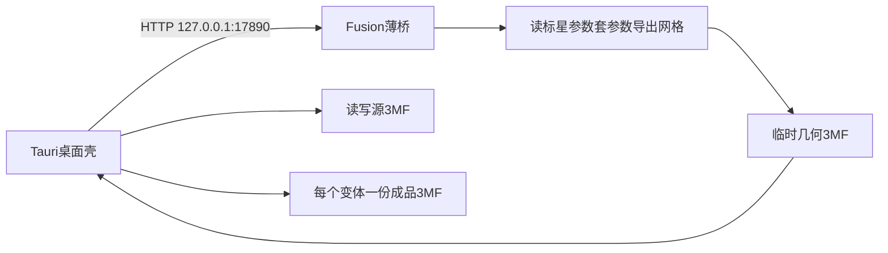

# Fusion + Bambu 3MF 新项目计划

## Review 结论与调整

通读后保留的定案不变：薄桥、3MF 唯一来源、Tauri 桌面壳、Ant Design、本机 HTTP、开发期可重载。

本轮调整：

1. **另起新仓，不改现有项目。** `Fusion360BatchParametricExport` 保持原样。本仓是 monorepo，内含桌面壳与桥插件；旧插件里的参数套用思路可参考，不复制 Excel/`openpyxl` 主流程。
2. **第一版不做 Excel。** 尺寸变体只存在于源 3MF 的扩展段，在 antd 表格里编辑。Excel 导入若以后要，另开迭代。
3. **补齐遗漏。** 固定桥端口、CORS/CSP、React 显式入栈、批量时自动备份/恢复参数、仓库目录结构、MVP 界面范围。
4. **删掉过时表述。** 不再写「旧导出可暂留」「Python 壳更顺」等已否决内容。

## 产品形态



- **Fusion 里**：只跑薄桥。无配置表、无复杂 CommandInputs。
- **桌面壳里**：选源 3MF、改打印覆盖、改尺寸变体、连接 Fusion、批量导出。
- **SSOT**：那一份源 3MF。Bambu 的 `model_settings` / `project_settings` 原样解析；尺寸变体进 `Metadata/fusion_batch_variants.json`。不另存旁路配置 JSON（最多记上次打开的文件路径）。

## 仓库结构

```text
FusionBambu3mf/
  apps/desktop/          # Tauri 2 + Vite + React + antd
  packages/3mf/          # 纯 TS：解包/改写/合并，供 desktop 与 Vitest
  fusion-bridge/         # Python add-in（可被安装包复制到 Fusion AddIns）
  samples/               # 探测用样例 3MF（若许可）
  .cursor/plans/         # 本计划
  README.md
```

## 技术栈

### Fusion 桥（Python）

- 标准库 `http.server` + 后台线程；API 调用只在 `fireCustomEvent` 主线程回调里
- 监听 `127.0.0.1:17890`（避开 Fusion MCP 常用 `27182`）
- 响应加 CORS（`Access-Control-Allow-Origin: *` 仅本机场景可接受），方便 WebView `fetch`
- `stop` 必须关闭 HTTP 服务并释放端口
- 入口几乎不写业务；子模块在 `run` 前从 `sys.modules` 剔除，保证开发期 stop/run 吃到新代码

第一版端点：

- `GET /health` → 桥版本、当前文档名、是否有活跃 Design
- `GET /parameters` → 标星参数（名、表达式、注释、单位若有）
- `GET /bodies` → 可见 Body 名列表（用于和 3MF part 名对表）
- `POST /parameters/apply` → `{ parameters }`；服务端先备份再应用
- `POST /parameters/restore` → 恢复最近一次备份
- `POST /export/mesh3mf` → 返回临时几何 3MF 路径或字节流（含当前可见 Body）

### 桌面主程序

| 层 | 选型 |
|----|------|
| 壳 | Tauri 2 |
| UI | React 18 + Vite + Ant Design 5 + `zh_CN` |
| 3MF | `packages/3mf`（`fflate` + XML 解析） |
| 调桥 | `fetch` → `http://127.0.0.1:17890`；Tauri CSP 允许连该源 |
| 文件 | Tauri 对话框选源 3MF 与导出目录 |
| 测试 | Vitest 测 `packages/3mf`；桥用 Fusion MCP |

UI 只组合 antd，不自研控件。MVP 屏：

1. 连接状态（health 轮询）+ 安装/重载桥提示
2. 源 3MF 路径 + 打开/保存
3. Part 列表与常用打印覆盖（顶层、底层、填充率、图案）；其余 metadata 保留不丢
4. 尺寸变体表（列 = 标星参数，行 = 变体）
5. 导出目录 + 进度 + 结果

### 为什么不是纯网页 / 不是改旧仓

- 纯网页写不了任意导出路径，和「3MF SSOT + 批量写出」冲突。
- 旧仓是 Excel 批量多格式导出，和本产品边界不同；硬改会搅在一起。新仓干净，旧工具可继续单独用。

## 安装与开发期重载

**用户安装：** 桌面安装包内置 `fusion-bridge/` → 复制到标准 AddIns 目录 → manifest `runOnStartup: true`。Fusion 未开时下次启动自启；已开且无任何进程内入口时无法隔空注入，提示重启即可。目标是用户不必进「脚本和插件」手点运行。

**开发重载：** MCP（或桌面开发按钮）对桥 `stop` + `run`；子模块清缓存。改 Tauri/前端用 Vite HMR，与桥无关。

## 实现顺序

1. **建仓。** monorepo 骨架；现有 BatchParametricExport 零改动。（已完成：本仓库）
2. **探测。** 真实 Bambu 工程 3MF + Fusion 双 Body 导出，确认名字能否对齐；定合并策略（按名替换网格，配置从源文件来）。
3. **桥 MVP。** health / parameters / bodies / apply / restore / export；MCP 脚本验证。
4. **3MF 库 + Vitest。** 解析、改常用键、写回变体段、合并网格。
5. **桌面 MVP。** 连接、打开源文件、编辑、写回、单变体导出跑通，再批量。
6. **安装路径。** 内置桥复制与连不上时的重启提示；README。

## 明确不做（第一版）

- 不改 `Fusion360BatchParametricExport`
- 不做 Excel / STEP / IGES / STL 旧导出迁移
- 不做负体积、支撑加强/阻挡（除非源 3MF 里已有，则原样保留）
- 不自研 UI 组件、不上 Electron、不做纯静态网页发行
- 不把 3MF 合并逻辑塞回 Fusion 进程

## 仍待执行时敲定（不挡开工）

- 导出是返回文件路径还是字节流（先路径更简单）
- 变体段 JSON 字段的精确 schema（探测完后定一版并写进 `packages/3mf`）
